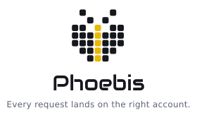

<!-- markdownlint-disable-file MD033 MD041 -->

  <picture>
    <source media="(prefers-color-scheme: dark)" srcset="assets/logo-dark.svg">
    
  </picture>

Phoebis Router relays Claude Code's requests to Anthropic under the credentials of an account it holds, and picks that
account from a pool: a session sticks to one account, a rate limit fails over to a sibling, prompt caches are kept
warm, and every request lands in a ledger the web console reads. Phoebis is a genus of sulphur butterflies, migrants
of the Americas that land on the right flower.

**A note on the terms.** Phoebis Router switches between Claude accounts that you personally own and pay for. Each
account's limits stay enforced by Anthropic, and switching accounts to work past a limit is a gray area under
[Anthropic's consumer terms](https://www.anthropic.com/legal/consumer-terms), so you run the router at your own risk.
The terms forbid sharing an account's login or credentials with anyone else, reselling access and bypassing Anthropic's
protective measures, and they say nothing about one person who holds several subscriptions. Do not back a shared or
commercial service with consumer subscriptions. On its own side the router never presents an SDK client as the CLI, and
an OAuth account refuses a request that names no user.

The documentation lives under [`docs/site/`](docs/site/index.md), starting with the
[Quick start](docs/site/quickstart.md), and is published at <https://daystrom-labs.github.io/phoebis/> once GitHub
Pages is enabled for the repository.

Released under the MIT license. See [`LICENSE`](LICENSE) for the full text.
